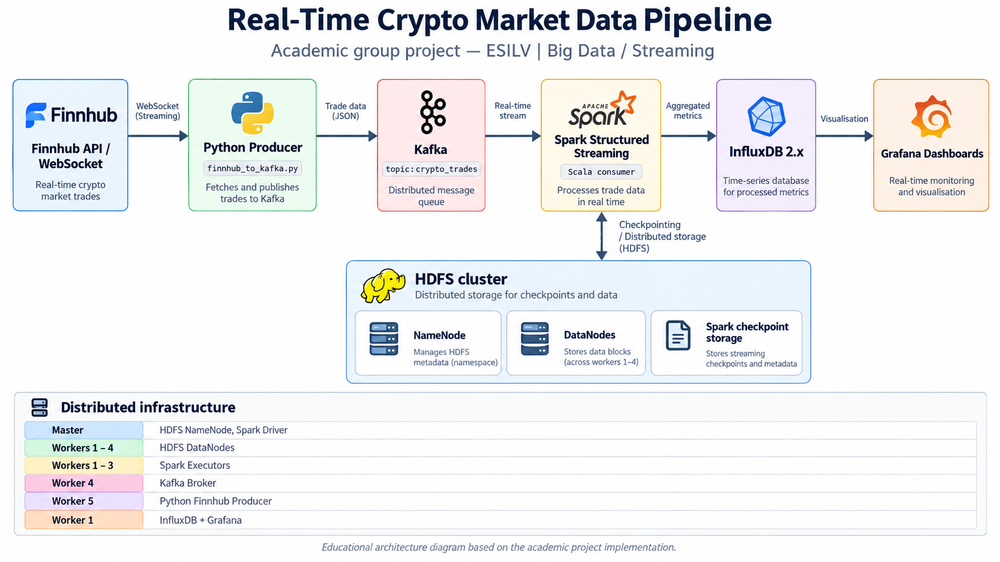

# Real-Time Crypto Market Data Pipeline

**Academic group project : ESILV | Big Data / Streaming**

A distributed streaming pipeline built to collect cryptocurrency market data, ingest events through Apache Kafka, transform the stream using Apache Spark Structured Streaming (Scala), store time-series measurements in InfluxDB, and visualize activity in Grafana. Hadoop HDFS supports distributed storage and Spark checkpoints.

## Architecture Diagram

### Distributed infrastructure

The academic cluster comprised **six Linux virtual machines** (one master, five workers):

| Role | Machine(s) |
| --- | --- |
| HDFS NameNode and Spark Driver | Master |
| HDFS DataNodes | Workers 1–4 |
| Spark Executors | Workers 1–3 |
| Kafka Broker | Worker 4 |
| Python Finnhub producer | Worker 5 |
| InfluxDB and Grafana | Worker 1 |

The original implementation uses lab-specific hostnames, IP addresses and service locations. The code is provided as an **educational reference**, not as a one-command production deployment.

## Stack

Python · Apache Kafka · Spark Structured Streaming (Scala) · Hadoop HDFS · InfluxDB 2.x · Grafana · Linux

## Demo

🎬 **[Watch the full project demonstration (Google Drive)](https://drive.google.com/drive/folders/1wJcun1Kyl4SrV5Y2aMt2G-Ui2xI_CYsL?usp=sharing)**

The demonstration showcases the real-time cryptocurrency data pipeline, from ingestion with Kafka and processing with Spark Streaming to visualization using InfluxDB and Grafana.

The video is also available in a compressed version in the [demo folder](demo/Big_Data_Demo.mp4).

## Source code

- [`src/producer/finnhub_to_kafka.py`](src/producer/finnhub_to_kafka.py): producer that retrieves Finnhub crypto market events and publishes JSON messages to Kafka.
- [`src/streaming/kafka_to_influx.scala`](src/streaming/kafka_to_influx.scala): Spark streaming consumer with JSON schema parsing and InfluxDB writing.
- [`docs/Presentation_Big_Data.pdf`](docs/Presentation_Big_Data.pdf): academic project presentation.

## How to run (requires existing cluster and installed services)

1. Provision and start Kafka, Hadoop HDFS, Spark 3.4.x, InfluxDB 2.x and Grafana. Configure network access between nodes.
2. Install the Python dependencies in `requirements.txt`.
3. Export `FINNHUB_API_KEY` and `KAFKA_BOOTSTRAP` on the producer node.
4. Start the producer: `python3 src/producer/finnhub_to_kafka.py`.
5. Export `INFLUXDB_TOKEN`, `INFLUXDB_URL`, `INFLUXDB_ORG`, `INFLUXDB_BUCKET` and `KAFKA_BOOTSTRAP` for the Spark process.
6. Start the Scala consumer with the appropriate Kafka connector libraries and `spark-shell -i src/streaming/kafka_to_influx.scala`.
7. Configure Grafana with InfluxDB as a data source and recreate the dashboards from the presentation.

**Important:** The Scala Spark checkpoint uses `hdfs://master:9000/tmp/chk_kafka_to_influx_crypto`, which must be adjusted to your cluster. The producer and Spark consumer defaults are localhost for safer distribution; override them using environment variables.

## Credits

This was a collaborative academic project. The original GitLab repository includes contributions by **Mazigh Mohammedi** and the rest of the student project team. This portfolio repository preserves the group-project attribution and does not claim sole authorship
